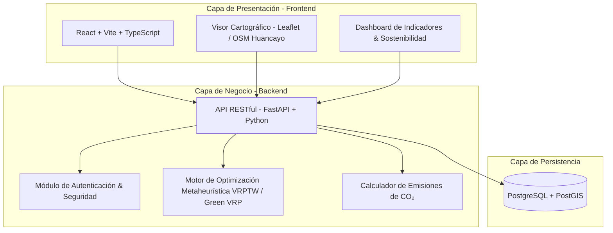
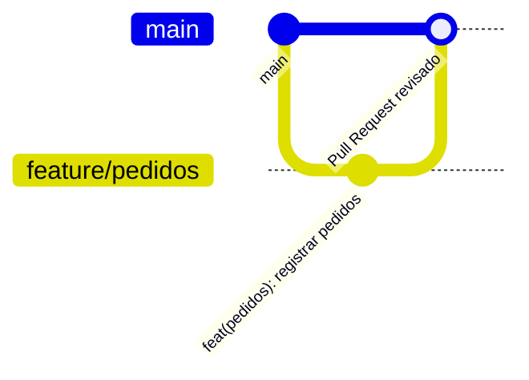

<div align="center">


# EcoLogística Huancayo
### Plataforma de Optimización de Rutas Sostenibles de Última Milla

[](https://github.com/alexito-dev/EcoLogistica/actions/workflows/ci.yml)
[](https://github.com/alexito-dev/EcoLogistica/actions/workflows/tests.yml)
[](https://github.com/alexito-dev/EcoLogistica/actions/workflows/deploy-production.yml)
[](docs/03%20Implementaci%C3%B3n/Sprint%2004)
[](docs/03%20Implementaci%C3%B3n/Sprint%2003/03%20Calidad%20de%20c%C3%B3digo%20V_1_0_0.md)
[](README.md)
[](docs/01%20Inicio/10.%20Stack%20tecnol%C3%B3gico%20V_1_1_0.md)
[](docs/01%20Inicio/01.%20Selecci%C3%B3n%20del%20enfoque%20del%20proyecto%20V_1_0_0.md)
[](README.md)
[](README.md)

<p align="center">
  <b>Solución tecnológica para la gestión eficiente, económica y ecológica de flotas de distribución urbana en DistriRápido S.A.C.</b>
</p>

</div>

---

## Estado actual (cierre del Sprint 4 · 20/11/2026)

**EcoLogística Huancayo** ayuda a la empresa DistriRápido S.A.C. a repartir pedidos en Huancayo con menos kilómetros, más puntualidad y menos CO₂. Una persona de **Planificación** registra los pedidos, genera y guarda las rutas del día y asigna conductor; la persona **Conductora** abre «Mi ruta», marca cada entrega y reporta incidencias; Planificación las atiende y los **Indicadores** muestran lo que realmente ocurrió.

| Qué se puede hacer hoy | Quién | Estado |
|---|---|---|
| Entrar con contraseña y código TOTP, con permisos por rol | Todos | Implementado |
| Registrar, listar e **importar pedidos por plantilla CSV** | Planificación | Implementado |
| Administrar vehículos y su disponibilidad diaria | Administración y Planificación | Implementado |
| Generar rutas por capacidad, ventana horaria y CO₂e, verlas en el mapa y **guardarlas** | Planificación | Implementado |
| Asignar conductor, seguir el avance, **reprogramar incidencias** y reoptimizar lo pendiente | Planificación | Implementado |
| **«Mi ruta»**: ver paradas en orden, marcar *En ruta*, *Entregado*, *Incidencia* o *Cancelado* | Conducción | Implementado |
| Indicadores estimados y **resultados observados** con entregas reales | Gerencia y Planificación | Implementado |

**Cómo se comprueba que funciona (todo automático en GitHub Actions):**

| Flujo | Qué hace | Estado |
|---|---|---|
| [`ci.yml`](.github/workflows/ci.yml) | Estilo, análisis estático, compilación, dependencias, migraciones en PostGIS y especificaciones | Insignia **CI** al inicio |
| [`tests.yml`](.github/workflows/tests.yml) | Pruebas unitarias e integración (PostGIS) y E2E con Playwright en Chromium, Firefox y WebKit; guarda los informes como artefactos | Insignia **Tests** |
| [`deploy-production.yml`](.github/workflows/deploy-production.yml) | Valida y despliega a producción con GitHub Secrets; si faltan los secretos, lo indica y no despliega | Insignia **Deploy production** |
| [`green-audit.yml`](.github/workflows/green-audit.yml) | Auditoría Lighthouse con umbrales de rendimiento y peso | Ejecución por rama |
| [`monitoreo.yml`](.github/workflows/monitoreo.yml) | Cada 6 horas sondea `/health` del entorno desplegado y registra disponibilidad y latencia | Se activa al definir `PRODUCTION_URL` |

Pruebas al cierre: **230 de backend** (9 de PostgreSQL se ejecutan solo en CI), **134 de frontend** y la suite E2E (24 pruebas en Chromium; los flujos críticos también en Firefox y WebKit).

**Qué falta (dicho con transparencia):**

- **Despliegue con URL pública:** el código está listo (`Dockerfile`, `render.yaml`, `deploy-production.yml`) y probado en local; falta crear la cuenta del hosting y cargar el secreto `DEPLOY_HOOK_BACKEND` y la variable `PRODUCTION_URL` (guía en la [sección 8.9](#89-despliegue-a-producción-un-solo-servicio)).
- **Usabilidad SUS:** el cálculo y el protocolo están listos, pero todavía no hay respuestas de personas reales (n = 0); no se estima un puntaje.
- **SonarQube vigente, protección de `main` y revisión por pares, y tarjetas de Jira del cierre:** pendientes (ver la [Retrospectiva](docs/03%20Implementaci%C3%B3n/Sprint%2004/02%20Retrospectiva%20del%20Sprint%20V_1_0_0.md#acciones-a-realizar)).
- **Motor VRPTW completo (EN-001):** el re-enrutamiento usa una heurística acotada.

**Entregables de la Inspección 5 (Sprint 4):** [01 Revisión](docs/03%20Implementaci%C3%B3n/Sprint%2004/01%20Revisi%C3%B3n%20del%20Sprint%20V_1_0_0.md) · [02 Retrospectiva](docs/03%20Implementaci%C3%B3n/Sprint%2004/02%20Retrospectiva%20del%20Sprint%20V_1_0_0.md) · [03 Análisis Playwright](docs/03%20Implementaci%C3%B3n/Sprint%2004/03%20Analisis%20PlayWrigth%20V_1_0_0.md) · [04 Usabilidad](docs/03%20Implementaci%C3%B3n/Sprint%2004/04%20Usabilidad%20V_1_0_0.md). El índice completo de documentos está en la [sección 9](#9-navegación-de-documentación).

<details>
<summary><b>Cortes anteriores: cobertura, Green IT y SonarQube</b></summary>

**Cobertura de pruebas — mejora posterior al Sprint 3:** nuestro [control de cobertura en CI](https://github.com/alexito-dev/EcoLogistica/actions/runs/41125601203) midió **95,14 % global**, **97,31 % en líneas** y **88,94 % en ramas**, con backend, frontend y PostGIS aislado. Establecimos el mínimo obligatorio del **90 % combinado** y alcanzamos la **meta ampliada del 95 %** en el indicador CI mediante `scripts/reporte_cobertura.py --min 90`. **No es un escaneo nuevo de SonarQube**: la medición oficial sigue pendiente de la instancia local. [Plan, evidencias y criterios](docs/03%20Implementaci%C3%B3n/20261030%20Cobertura%20SonarQube%2090-95%20-%20plan%20y%20evidencia.md).

**Inspección 04 — Green IT (13/11/2026):** reducimos **96,5 %** el peso de la carga inicial (1,21 MB → 0,04 MB; 0,1672 g → 0,0058 g de CO₂e por visita con SWDM v4) y subimos el rendimiento Lighthouse móvil de 74 a 100 (escritorio 100). Aplicamos las 8 optimizaciones al stack real (React + FastAPI + PostGIS), con auditoría automática en [`green-audit.yml`](.github/workflows/green-audit.yml). Se cumplen todos los umbrales de la rúbrica en móvil (FCP 0,92 s, LCP 1,22 s, TBT 41 ms, CLS 0) y en escritorio; la medición es de la pantalla de acceso en primera visita. [Informe](docs/03%20Implementaci%C3%B3n/reduccion%20del%20impacto%20ambiental/01%20Informe%20de%20reduccion%20del%20impacto%20ambiental%20V_1_1_0.md) · [Estándares y matriz de mapeo](docs/03%20Implementaci%C3%B3n/reduccion%20del%20impacto%20ambiental/02%20Estandares%20Ingenier%C3%ADa%20de%20software%20V_1_1_0.md).

**SonarQube:** el análisis documentado como PASSED corresponde al commit histórico `9b31dd0`, no a todos los cambios posteriores. Consultar la [validación de vigencia y guía de reanálisis](docs/03%20Implementaci%C3%B3n/Sprint%2003/20261030%20Validaci%C3%B3n%20del%20reporte%20SonarQube%20y%20rean%C3%A1lisis.md). El CI ya incluye el paso de SonarScanner con puerta de calidad, que se activa al definir los secretos `SONAR_TOKEN` y `SONAR_HOST_URL` del repositorio (ver [Pruebas E2E y calidad](docs/03%20Implementaci%C3%B3n/Sprint%2004/07%20Calidad%20inicial%20E2E%20y%20SonarQube%20V_1_0_0.md)); mientras no existan, se omite y la medición oficial sigue pendiente.

</details>

## 1. Ficha Técnica del Proyecto

| Campo | Especificación |
| :--- | :--- |
| **Proyecto / Producto** | **EcoLogística Huancayo** (Optimizador VRPTW & Green VRP) |
| **Empresa Patrocinadora** | **DistriRápido S.A.C.** |
| **Asignatura Académica** | **Taller de Proyectos 2** (Ingeniería de Sistemas e Informática) |
| **Docente Asesor** | **Ing. Gamarra Moreno, Job Daniel** |
| **Periodo de Ejecución** | **24/08/2026 – 05/12/2026** (14 semanas de desarrollo + 1 de cierre / 4 iteraciones) |
| **Ámbito Geográfico** | **Huancayo y Junín** (Huancayo Cercado, El Tambo, Chilca, Pilcomayo y San Agustín de Cajas) |
| **Repositorio Oficial** | `https://github.com/alexito-dev/EcoLogistica.git` |

---

## 2. Descripción y Problemática

### 2.1. Descripción
**EcoLogística Huancayo** es una plataforma web desarrollada como Producto Mínimo Viable (PMV) enfocada en la planificación inteligente, secuenciación y seguimiento de rutas de distribución de última milla. 

El núcleo del sistema integra modelos matemáticos de optimización combinatoria multiobjetivo (**VRPTW** - *Vehicle Routing Problem with Time Windows*) incorporando variables de sostenibilidad ambiental (**Green VRP**) para minimizar distancias, tiempos de traslado, consumo de combustible y la emisión de dióxido de carbono ($CO_2$) generada por el transporte en altitud (3,250 msnm).

### 2.2. Problemática en DistriRápido S.A.C.
La operativa logística en el valle del Mantaro presenta retos críticos que impactan en la rentabilidad y sostenibilidad de la empresa:
1. **Sobrecostos de combustible:** Recorridos redundantes, cruces innecesarios de avenidas principales y desbalance de carga entre vehículos.
2. **Incumplimiento de ventanas horarias:** Dificultad para garantizar entregas en horarios concertados ante variaciones de tráfico urbano.
3. **Huella de carbono no mitigada:** Carencia de herramientas analíticas para cuantificar y reducir las emisiones de gases de efecto invernadero.
4. **Baja capacidad de respuesta:** Falta de re-optimización dinámica en tiempo real ante cancelaciones o nuevos pedidos urgentes durante la jornada.

### 2.3. Objetivo General
Desarrollar e implementar un PMV web que optimice las rutas de distribución urbana de DistriRápido S.A.C. en Huancayo, reduciendo la distancia total recorrida en al menos un **15%**, elevando la puntualidad al menos al **92%** y calculando la reducción efectiva de emisiones de $CO_2$ en 14 semanas de desarrollo y una semana de cierre.

### 2.4. Avance por sprint (con los cortes históricos)

> **Corte histórico.** Los dos párrafos siguientes describen el estado al **09/10/2026** (107 pruebas de backend y 39 de frontend) y se conservan como registro. Lo que sigue pendiente allí (persistencia de usuarios y rutas, mapa, motor y despliegue) se resolvió después, salvo lo indicado en «Estado actual» al inicio de este README.

La línea base tecnológica vigente es **React + Vite + TypeScript** para la interfaz, **FastAPI + Python** para la API y **PostgreSQL/PostGIS** para pedidos, ubicaciones, vehículos y disponibilidades. La línea base funcional se reordenó el 09/10: Sprint 1 reúne el acceso MFA/roles y los pedidos persistentes; Sprint 2, la gestión de flota; Sprint 3, las rutas. La documentación y las metas de Jira se actualizaron para reflejar esa decisión, conservando los cortes históricos. Siguen pendientes la persistencia de usuarios y rutas, Leaflet/OpenStreetMap y el motor de optimización. La matriz y el alcance están en [10. Stack tecnológico](docs/01%20Inicio/10.%20Stack%20tecnol%C3%B3gico%20V_1_1_0.md).

El sistema permite entrar con TOTP y roles, registrar pedidos, volver a encontrarlos y consultar su detalle. Los pedidos y sus coordenadas se guardan en PostgreSQL/PostGIS y se comprobó que siguen ahí tras reiniciar la API. El 09/10/2026 pasaron **107 pruebas de backend y 39 de frontend**; también terminó la compilación de producción. El incremento de flota se recorrió visualmente con MFA en un PostGIS aislado y continuó disponible tras reiniciar la API. El linter termina con dos avisos de `set-state-in-effect`, uno preexistente en pedidos y otro en la nueva vista de flota. No hay todavía pruebas automatizadas que integren los adaptadores PostgreSQL; la persistencia se comprobó manualmente en bases aisladas. La compilación avisa que faltan los archivos de la fuente Codec Pro. Aún no hay optimización de rutas ni despliegue continuo.

| Sprint | Alcance funcional vigente | Estado documentado |
|---|---|---|
| Sprint 1 · 14/09–28/09; cierre registrado 09/10 | Línea base vigente: acceso MFA/roles y pedidos con persistencia. | El recorrido está implementado y comprobado, incluida la persistencia tras reiniciar la API. El compromiso original conserva su resultado de 0/2 al 28/09; la lectura dinámica actual de Jira es 1/2 (ECO-9 `Listo`, ECO-15 `Por hacer`) y no se cuenta como velocidad histórica. ECO-15 conserva su asociación al Sprint 1 cerrado y sigue pendiente. |
| Sprint 2 · 29/09–12/10, alcance reordenado | Administración mantiene vehículos; Planificación configura disponibilidad y turnos por fecha. | El E2E web aprobó los cinco criterios funcionales y Jira refleja ECO-12 y ECO-19 en `Listo` (2/2, 10 puntos). Pasaron 107 pruebas de backend, 39 de frontend y la compilación de producción. El usuario confirmó el 09/10 la aprobación del incremento. El sprint permanece activo hasta su cierre administrativo. |
| Sprint 3 · en revisión (Inspección 03) | Planificación genera, guarda y vuelve a consultar rutas para pedidos pendientes usando vehículos elegibles. | Al 30/10: rutas en mapa (Leaflet/OSM + OSRM) que se guardan por fecha y se reabren tras reiniciar, indicadores de CO₂e, benchmark del motor y CI en GitHub Actions. Cumplen los 5 criterios; las rutas se guardan en un archivo local y pasan a PostgreSQL en el Sprint 4 (EN-005). Calidad, seguridad y accesibilidad evaluadas con SonarQube, OWASP Top 10:2025 y WCAG 2.2 AA. Ver [Sprint 03](#93-fase-03-implementación). |
| Sprint 4 · corte 20/11/2026 (Inspección 5) | Conducción consulta una ruta, registra avances e incidencias; Planificación puede revisarlos y actuar. | Implementado y verificado con pruebas E2E en navegador real (Chromium, Firefox y WebKit): «Mi ruta», avance de entregas, incidencias, seguimiento, reprogramación, reoptimización de pendientes e indicadores observados con entregas reales (ECO-14/ECO-26) e importación de pedidos por plantilla CSV (ECO-18). Incluye ECO-21 (cuentas, rutas y avance en PostgreSQL; TOTP cifrado), ECO-24 (WCAG 45/45 por pruebas), ECO-27 (Playwright), el cierre técnico de CI/CD, rendimiento y disponibilidad, la medición de usabilidad y la Inspección 04 (Green IT). La persistencia en PostgreSQL se verificó en GitHub Actions ([CI en verde](https://github.com/alexito-dev/EcoLogistica/actions/runs/43453357665)), no en la máquina de desarrollo. Ver la [Revisión del Sprint 04](docs/03%20Implementaci%C3%B3n/Sprint%2004/01%20Revisi%C3%B3n%20del%20Sprint%20V_1_0_0.md). |

Jira ya refleja la rebase funcional: ECO-12 y ECO-19 están en `Listo` dentro del Sprint 2; ECO-16 y ECO-20 constan completadas fuera del Sprint 1 cerrado, sin alterar la velocidad histórica. ECO-15 sigue `Por hacer` y conserva su asociación al Sprint 1 cerrado como compromiso pendiente de replanificar. ECO-21 se limita a persistencia de cuentas y rutas y protección de secretos TOTP. La configuración actual de `ECO board` tiene cuatro columnas en español (`Por hacer`, `En curso`, `En revisión / QA`, `Listo`) con categorías alineadas; el estado duplicado `Finalizada` se retiró y no hay incidencias en ese estado. Jira aún no tiene una versión de entrega. El detalle está en [02. Artefactos Jira](docs/02%20Planificaci%C3%B3n/02%20Artefactos%20Jira%20V_1_0_0.md).

**Corte del Sprint 3 (30/10/2026).** La rama `sprint-3/calidad-owasp-wcag` integra `feature/rutas-indicadores` y pasa **137 pruebas de backend y 58 de frontend** (cobertura de líneas del backend: 92,6 %; SonarQube midió **82,8 %** en su análisis del 30/10 con backend y frontend). SonarQube da *Quality Gate* **PASSED**, 0 bugs, 0 vulnerabilidades, 0 *hotspots* y 0,0 % de duplicación; fiabilidad C por 3 incidencias abiertas (ver [03 Calidad de código](docs/03%20Implementaci%C3%B3n/Sprint%2003/03%20Calidad%20de%20c%C3%B3digo%20V_1_0_0.md)). En OWASP Top 10:2025 no quedan vulnerabilidades críticas abiertas, y la auditoría WCAG 2.2 AA alcanza **88,9 %** de los criterios aplicables (meta ≥ 90 %). Detalle en los [documentos del Sprint 03](#93-fase-03-implementación).

**Cierre del Sprint 4 (20/11/2026).** Pasan **230 pruebas de backend (9 de PostgreSQL omitidas localmente y ejecutadas en CI), 134 de frontend y la suite E2E de Playwright (24 pruebas en Chromium y los flujos críticos en Firefox y WebKit) contra el build de producción**. La auditoría WCAG 2.2 AA pasa de 88,9 % a **45 de 45 criterios aplicables verificados por prueba** (sin certificación ni pruebas con lectores de pantalla). El cálculo de cobertura y el análisis SonarQube de los cortes anteriores **no se rehicieron** con el código nuevo. Detalle en la [Revisión del Sprint 04](docs/03%20Implementaci%C3%B3n/Sprint%2004/01%20Revisi%C3%B3n%20del%20Sprint%20V_1_0_0.md).

La línea base funcional acordada para Sprint 1–4 está en [05. Plan funcional de sprints](docs/02%20Planificaci%C3%B3n/05%20Plan%20funcional%20de%20sprints.md), con criterios para flota y rutas y con los cortes históricos preservados.

---

> **Cierre de sprints al 30/10/2026:** Como equipo, verificamos los tres sprints oficiales **cerrados** en Jira: Sprint 1 (id 36, historial preservado), Sprint 2 (id 37, 2/2 historias y 10/10 puntos) y Sprint 3 (id 38, 4/4 entregables del incremento delimitado: ECO-22, ECO-23, ECO-17 y ECO-25). El Sprint 3 se creó e inició administrativamente el 30/10 y se cerró el mismo día; el trabajo técnico se desarrolló previamente y **no** reconstruimos una velocidad histórica. El dashboard reporta **estimaciones**, no resultados de entregas reales. [Acta consolidada y pendientes](docs/03%20Implementaci%C3%B3n/20261030%20Acta%20consolidada%20de%20cierre%20Sprints%2001-03.md) · [Matriz Jira](docs/02%20Planificaci%C3%B3n/02%20Artefactos%20Jira%20V_1_0_0.md#cierre-administrativo-verificado-de-los-tres-sprints--30102026).

## Regularización técnica de Sprint 1–3 (30/10/2026, histórico)

Como equipo, estamos conciliando los incrementos técnicos de los tres primeros sprints con los criterios de Jira. **Esta actividad no constituye un cierre retroactivo ni una certificación de producción.** Hemos registrado correcciones de durabilidad en los repositorios JSON temporales de autenticación y rutas, así como pruebas de regresión frente a errores de escritura. Estas medidas no sustituían la migración definitiva a PostgreSQL/PostGIS ni el cifrado en reposo de los secretos TOTP, que se completaron después en el Sprint 4 ([ECO-21](https://continental-team-ecologistica.atlassian.net/browse/ECO-21)).

Conservamos los cortes originales del 09/10 y 30/10; cuando el texto siguiente se refiere a un corte anterior no debe interpretarse como estado final de esta regularización. En Jira se han creado [ECO-22](https://continental-team-ecologistica.atlassian.net/browse/ECO-22) (generación/recuperación de rutas) y [ECO-23](https://continental-team-ecologistica.atlassian.net/browse/ECO-23) (benchmark). Actualizamos [ECO-17](https://continental-team-ecologistica.atlassian.net/browse/ECO-17) para reconocer GitHub Actions, manteniendo pendientes E2E/Playwright y pruebas de integración de PostGIS. [ECO-13](https://continental-team-ecologistica.atlassian.net/browse/ECO-13) y [ECO-14](https://continental-team-ecologistica.atlassian.net/browse/ECO-14) permanecían abiertas al 30/10 por criterios de aceptación no acreditados íntegramente; su alcance se implementó en el Sprint 4 (Mi ruta e indicadores observados) y su estado en Jira debe actualizarse.

Toda modificación se entrega mediante [PR #3](https://github.com/alexito-dev/EcoLogistica/pull/3), sujeto a CI y revisión; no publicamos información de autenticación ni alteramos velocidades históricas. Consultar el [plan transversal de regularización](docs/03%20Implementaci%C3%B3n/Regularizacion%20Sprints%2001-03%20-%2020261030.md) y los complementos de cada sprint.

---

## 3. Capacidades y Módulos Funcionales

| Módulo | Qué hace | Estado al 20/11/2026 |
|---|---|---|
| Gestión de pedidos | Registro, validación de ventanas y ámbito, listado paginado e importación por plantilla CSV | Implementado |
| Flota y conductores | Catálogo de vehículos, capacidades, combustible y disponibilidad diaria; asignación de conductor a cada ruta | Implementado |
| Motor de rutas | Asignación por capacidad (kg y m³), prioridad y ventana; orden por inserción, vecino más cercano y 2-opt; pedidos no asignados con su causa | Implementado con heurística; el motor VRPTW completo (EN-001) sigue en el backlog |
| Visor cartográfico | Mapa Leaflet/OpenStreetMap con depósito, paradas numeradas y trazado por calles (OSRM) | Implementado |
| Dashboard de indicadores | CO₂e y puntualidad **estimados** y **resultados observados** con entregas registradas | Implementado |
| Conducción («Mi ruta») | Paradas en orden, avance de entregas e incidencias | Implementado |
| Seguimiento y re-enrutamiento | Incidencias visibles, reprogramación y reoptimización de lo pendiente | Implementado con alcance acotado |

---

## 4. Equipo de Trabajo y Responsabilidades

| Integrante | Rol en el Proyecto | Responsabilidad Principal |
| :--- | :--- | :--- |
| **Zorrilla Apumayta, Alex Jesus** | **Director del proyecto / Líder** | Planificación, gestión del alcance, coordinación metodológica, control de entregables y gobernanza del proyecto. |
| **Anco Porras, Jhean Pier Julio** | **Arquitecto / servicios API** | Arquitectura del software, diseño y desarrollo de API RESTful, modelos de datos, persistencia en BD y servicios de negocio. |
| **Hilario Talavera, Alexander Daniel** | **Optimización** | Modelado matemático, formulación y calibración del motor metaheurístico multiobjetivo (VRPTW & Green VRP). |
| **Vera Zea, Jhoanna Hade** | **Interfaz / experiencia de usuario** | Diseño de experiencia de usuario (UI/UX), desarrollo de vistas web responsivas, componentes de mapas interactivos y dashboards. |
| **Isidro Casio, Jose Luis** | **Calidad / operaciones de desarrollo** | Aseguramiento de la calidad, diseño y ejecución de pruebas unitarias/integración, pipelines de CI/CD y gestión de ramas. |
| **Gamarra Moreno, Job Daniel** | **Docente** | Asesoría técnica especializada, validación metodológica, evaluación de hitos académicos y supervisión general. |

---

## 5. Arquitectura del Sistema

El diagrama representa la arquitectura del PMV. Al 20/11/2026 están implementados la interfaz, la API, el acceso con MFA y roles, los pedidos, la flota, las rutas, la conducción y los indicadores, con cuentas, rutas y avance persistidos en PostgreSQL/PostGIS. El «Motor de Optimización» es la heurística de rutas descrita en la sección 3; el motor metaheurístico VRPTW completo sigue pendiente. El entorno de producción aún no está desplegado.



### 5.1. Herramientas y tecnologías

- **Frontend:** React con Vite y TypeScript.
- **Estilos e interfaz:** CSS (con diseño responsivo y enfoque de bajo consumo para 2G/3G).
- **Backend:** Python con FastAPI, Pydantic y SQLAlchemy/Alembic.
- **Base de datos:** PostgreSQL con PostGIS.
- **Cartografía:** Leaflet y OpenStreetMap.
- **Optimización:** heurística de asignación y ordenamiento de rutas (VRPTW completo pendiente).
- **Pruebas:** pytest, Vitest y Playwright (Chromium, Firefox y WebKit).
- **Automatización:** GitHub Actions (`ci.yml`, `tests.yml`, `deploy-production.yml`, `green-audit.yml`).
- **Rendimiento y huella de carbono:** Preact en el build de producción, Lighthouse CI y modelo SWDM v4.

---

## 6. Estructura del Repositorio

```text
EcoLogistica/
├── .github/                       # Plantillas de incidencias/PR y flujos: ci.yml, tests.yml, deploy-production.yml, green-audit.yml
├── assets/                        # Logotipo y evidencias de Jira
├── backend/
│   ├── src/app/auth/              # Autenticación, MFA, roles y auditoría
│   ├── src/app/pedidos/           # Dominio, API y repositorios en memoria y PostgreSQL/PostGIS
│   ├── src/app/flota/             # Catálogo de vehículos y disponibilidad diaria
│   ├── src/app/rutas/             # Vista previa de rutas (asignación por capacidad, ventanas y CO₂e)
│   ├── src/app/indicadores/       # Indicadores estimados y resultados observados
│   ├── src/app/conduccion/        # «Mi ruta», avance de entregas, incidencias y seguimiento
│   └── tests/                     # Pruebas de API, servicios y dominio
├── database/migrations/           # Migraciones Alembic (PostGIS)
├── docs/
│   ├── 01 Inicio/                 # Acta, alcance, requisitos y arquitectura
│   ├── 02 Planificación/          # Backlog, Jira, riesgos y presupuesto
│   ├── 03 Implementación/         # Informes, revisión, retrospectiva e impedimentos
│   │   ├── Sprint 01/             # Artefactos del primer sprint
│   │   ├── Sprint 02/             # Artefactos del segundo sprint
│   │   ├── Sprint 03/             # Revisión, retrospectiva, SonarQube, OWASP, WCAG, informe, impedimentos, minuta, plan, GitFlow y pruebas
│   │   └── Sprint 04/             # Inspección 5: revisión, retrospectiva, análisis Playwright, usabilidad SUS y soportes (WCAG, calidad, Nielsen)
│   ├── 04 Seguimiento y Control/  # Carpeta reservada; aún sin entregables
│   ├── 05 Cierre/                 # Carpeta reservada; aún sin entregables
│   └── otros/                     # Reservado para soporte técnico
├── scripts/                       # Demostración local, cobertura, huella de carbono (SWDM v4) y usabilidad SUS
├── frontend/
│   ├── src/                       # Interfaz React/Preact, autenticación y cliente API
│   ├── e2e/                       # Pruebas E2E con Playwright (Chromium, Firefox y WebKit)
│   ├── tests/                     # Pruebas con Vitest y Testing Library
│   └── public/                    # Logotipo y guía de fuentes
├── openspec/
│   ├── specs/                     # Especificaciones vigentes
│   └── changes/archive/           # Cambios implementados y archivados
├── Dockerfile                     # Imagen de producción de un solo servicio (API + interfaz compilada)
├── render.yaml                    # Plano de infraestructura para Render (servicio web + PostgreSQL)
├── deploy/arranque.sh             # Migraciones y arranque del servicio de producción
├── .env.example                   # Variables de entorno de ejemplo, sin secretos
├── sonar-project.properties       # Configuración del análisis de SonarQube
└── README.md                      # Guía y estado del proyecto
```

---

## 7. Modelo de Ramas y Control de Versiones

El flujo definido usa **ramas cortas desde `main` y revisión mediante Pull Request hacia `main`**. No se requiere una rama `develop`; `main` es la rama de integración y cada cambio conserva commits descriptivos con Conventional Commits.



### 7.1. Ramas y revisión
- `main`: rama compartida de integración. Cada `push` a `main` dispara `deploy-production.yml`, que despliega solo si están definidos los secretos del hosting.
- `feature/*`: rama temporal creada desde `main` para una tarea y enviada mediante Pull Request.
- No se usa `develop` ni se mantienen ramas `release/*` permanentes.
- La revisión por pares y la protección de `main` siguen pendientes; el CI se ejecuta en `main`, `sprint-*/**`, `feature/**` y en cada PR. El historial reciente incluye cambios integrados directamente en `main`, por lo que el flujo descrito aún no está aplicado de forma uniforme.

### 7.2. Convención de Commits (Conventional Commits v1.0.0)
- `feat:` Nuevas funcionalidades (`feat(pedidos): agregar validacion de ventanas horarias`).
- `fix:` Corrección de errores (`fix(motor): ajustar calculo de penalizacion por demora`).
- `docs:` Actualización de documentación (`docs(inicio): actualizar acta de constitucion`).
- `test:` Pruebas unitarias o de integración (`test(backend): agregar pruebas del servicio de rutas`).
- `refactor:` Mejoras en código sin alterar comportamiento (`refactor(api): modularizar controladores`).
- `style:` Ajustes estéticos o de formato (`style(ui): optimizar paleta accesible en dashboard`).
- `chore:` Tareas de mantenimiento o configuración (`chore(deps): actualizar dependencias`).

---

## 8. Guía de Instalación y Ejecución Local

### 8.1. Clonar el Repositorio
```powershell
git clone https://github.com/alexito-dev/EcoLogistica.git
cd EcoLogistica
```

### 8.2. Variables de Entorno

En PowerShell, desde la raíz del repositorio:

```powershell
Copy-Item .env.example .env
```

El archivo incluye CORS, ámbito geográfico, autenticación y conexión local a PostgreSQL/PostGIS. Antes de levantar la base, reemplaza `REEMPLAZAR_POR_UN_SECRETO_ALEATORIO` por una clave aleatoria en `POSTGRES_PASSWORD` y `DATABASE_URL`. Genera además `TOTP_CLAVE_CIFRADO` (instrucción en `.env.example`) y guárdala fuera de Git. `.env` está ignorado por Git; no subas ese archivo.

### 8.3. Despliegue Local

Requisitos: Python 3.10+, Node.js 20.19+ o 22.12+ (requisito de Vite 8 según `frontend/package-lock.json`) y Docker Desktop para la base PostGIS. Si no puedes usar Docker, la [demostración con un solo comando](#831-demostración-con-un-solo-comando-sin-docker) funciona sin base de datos real.

```powershell
# Desde la raíz, una vez configurados POSTGRES_PASSWORD y DATABASE_URL en .env:
docker compose up -d database

# Backend: crea/actualiza el esquema y arranca FastAPI
Set-Location backend
python -m venv .venv
.\.venv\Scripts\python.exe -m pip install -r requirements.txt
.\.venv\Scripts\alembic.exe -c alembic.ini upgrade head
.\.venv\Scripts\python.exe -m uvicorn app.main:app --app-dir src --reload --port 8000

# API y OpenAPI: http://localhost:8000 y http://localhost:8000/docs

# Frontend (React + Vite), en otra terminal: http://localhost:3000
Set-Location frontend
npm.cmd ci
npm.cmd run dev
```

### 8.3.1. Demostración con un solo comando (sin Docker)

```powershell
powershell -ExecutionPolicy Bypass -File scripts\iniciar-demo.ps1
```

Abre la API (puerto 8001) y la pantalla (puerto 3000) con datos sintéticos de Huancayo y archivos temporales, sin base de datos real. La contraseña de demostración que imprime el script es solo para esa instancia local descartable; el ingreso exige además el código de una app autenticadora.

### 8.4. Pruebas Automatizadas
```powershell
# Desde la raíz del repositorio, con el entorno backend instalado
Push-Location backend
.\.venv\Scripts\python.exe -m pytest --cov=app
Pop-Location

# Frontend (Vitest + Testing Library)
Push-Location frontend
npm.cmd test
Pop-Location

# Benchmark del motor de rutas (EN-001)
Push-Location backend
.\.venv\Scripts\python.exe scripts\benchmark_rutas.py
Pop-Location
```

### 8.4.1. Auditoría Green IT (Inspección 04)

```powershell
# Compilar con NODE_ENV=production fijado (no usar `vite build` directo) y auditar con Lighthouse CI
Push-Location frontend; npm.cmd run build; Pop-Location
npx.cmd --yes @lhci/cli@0.14.0 autorun --config=./lighthouserc.json   # requiere Chrome (CHROME_PATH)

# Peso del listado de pedidos antes/después de paginar y comprimir, y CO2e por visita (SWDM v4)
Push-Location backend; .\.venv\Scripts\python.exe scripts\medir_api_verde.py 100; Pop-Location
python scripts\calcular_swdm.py lighthouse-reports\<antes>.report.json lighthouse-reports\<despues>.report.json

# Huella de CO2e por módulo (compilar ANTES y DESPUÉS con `vite build --manifest`)
python scripts\calcular_swdm_modulos.py <frontend_antes> <frontend_despues>
```

### 8.4.2. Pruebas E2E (Playwright)

```powershell
Push-Location frontend
npm.cmd ci
npx.cmd playwright install chromium firefox webkit   # una sola vez
npx.cmd playwright test        # levanta API (8000) y UI (3000) con datos temporales; Chromium usa el Chrome instalado
npx.cmd playwright test --project=webkit    # un solo navegador: chromium, firefox o webkit
npx.cmd playwright show-report              # informe HTML de la última ejecución
Pop-Location
```

Chromium ejecuta toda la suite; Firefox y WebKit ejecutan los flujos críticos y la disponibilidad/resiliencia. Contra un entorno ya desplegado (prueba de humo): `$env:ECO_BASE_URL='https://…'; $env:ECO_API_URL='https://…'; npx.cmd playwright test e2e/disponibilidad.spec.ts --project=chromium`. Análisis completo en [03 Análisis Playwright](docs/03%20Implementaci%C3%B3n/Sprint%2004/03%20Analisis%20PlayWrigth%20V_1_0_0.md).

### 8.4.3. Automatización CI/CD (GitHub Actions)

- **Se ejecuta sola** al hacer `push` o abrir un Pull Request (`ci.yml` y `tests.yml`) y al subir a `main` (`deploy-production.yml`).
- **A mano:** pestaña *Actions* del repositorio, elegir el flujo, **Run workflow** y la rama. Los informes de Playwright quedan en *Artifacts* al final de la ejecución.
- **Secretos del despliegue** (Settings → Secrets and variables → Actions): el secreto `DEPLOY_HOOK_BACKEND` y la variable `PRODUCTION_URL`. Sin ellos el flujo valida el código y avisa «no se desplegó». Opcionales: `DEPLOY_HOOK_FRONTEND` y `PRODUCTION_API_URL` (solo si interfaz y API se alojan por separado) y, para calidad, `SONAR_TOKEN` y `SONAR_HOST_URL`.

### 8.4.4. Usabilidad SUS (Sprint 4)

```powershell
python scripts\usabilidad\procesar_sus.py respuestas_sus.csv --markdown   # tablas, cálculo paso a paso y grado A–F
```

### 8.5. Análisis de calidad con SonarQube

```powershell
# Cobertura que lee SonarQube
Push-Location backend;  .\.venv\Scripts\python.exe -m pytest --cov=app --cov-report=xml:coverage.xml; Pop-Location
Push-Location frontend; npx.cmd vitest run --coverage; Pop-Location

# Con un servidor SonarQube en marcha y un token de análisis en $env:SONAR_TOKEN:
sonar-scanner -D"sonar.host.url=http://localhost:9000" -D"sonar.token=$env:SONAR_TOKEN"
```

La configuración está en [`sonar-project.properties`](sonar-project.properties). Resultados y procedimiento completo en [03. Calidad de código](docs/03%20Implementaci%C3%B3n/Sprint%2003/03%20Calidad%20de%20c%C3%B3digo%20V_1_0_0.md).

### 8.6. Acceso con verificación en dos pasos (RF-11.1)

Toda la aplicación exige **contraseña + código TOTP** de una app autenticadora (Google Authenticator, Microsoft Authenticator u otra).

1. En un entorno local nuevo, al iniciar el backend se crean **cinco usuarios de demostración**, uno por rol: `admin@ecologistica.test`, `planificador@ecologistica.test`, `conductor@ecologistica.test`, `gerente@ecologistica.test` y `auditor@ecologistica.test`. Para recorrer el Sprint 2, usa `planificador@ecologistica.test`.
2. Antes de ese primer inicio, puedes definir `DEMO_CLAVE` en `.env` con una contraseña local. Si la dejas vacía, el backend genera una aleatoria y **la muestra una sola vez en su consola**. Esa configuración solo se usa al crear las cuentas por primera vez; cambiarla después no reemplaza las contraseñas guardadas.
3. En el primer ingreso de cada usuario, la app muestra un **código QR** (y la clave para ingreso manual): escanéelo con la app autenticadora y escriba el código de 6 dígitos.
4. Permisos actuales (matriz RBAC del documento 08): **Planificador** registra y consulta pedidos, gestiona rutas, asigna conductores y atiende incidencias; **Administrador** consulta y supervisa; **Conductor** consulta su ruta asignada y registra el avance de sus entregas («Mi ruta»); **Gerente** ve Indicadores; **Auditor** ve "Acceso no autorizado" hasta que existan sus vistas.

Estas cuentas locales **no están conectadas al correo institucional**. El archivo `backend/.data/usuarios.json` conserva hashes de contraseña y secretos TOTP, no las contraseñas originales. Si se pierde una contraseña, no se puede recuperar desde ese archivo y actualmente el proyecto no ofrece una recuperación desde la interfaz. No borres `backend/.data/` para intentar obtenerla: esa carpeta guarda las cuentas y su configuración de acceso. El ingreso también requiere el código de una app autenticadora.

Seguridad: contraseñas con Argon2id, sesión en cookie `HttpOnly` y `SameSite=Strict` (15 min de inactividad, 8 h máximo), bloqueo de 15 min tras 5 intentos fallidos, códigos de un solo uso y eventos de acceso en la consola del backend sin secretos.

| Método | Ruta | Descripción |
| :--- | :--- | :--- |
| `POST` | `/api/v1/auth/login` | Paso 1: correo y contraseña (responde `MFA` o `ENROLAR`) |
| `POST` | `/api/v1/auth/mfa` | Paso 2: código TOTP; crea la sesión |
| `GET` | `/api/v1/auth/sesion` | Usuario de la sesión vigente |
| `POST` | `/api/v1/auth/logout` | Cierra la sesión e invalida los tokens emitidos |

### 8.7. API de pedidos (HU-001)

| Método | Ruta | Descripción |
| :--- | :--- | :--- |
| `POST` | `/api/v1/pedidos` | Registra un pedido (estado inicial `PENDIENTE`) |
| `GET` | `/api/v1/pedidos?estado&pagina&limite` | Lista pedidos, del más reciente al más antiguo (límite máx. 100) |
| `GET` | `/api/v1/pedidos/{id}` | Consulta un pedido por UUID |

Requiere sesión (`401`) y rol (`403`). Errores: `400` formato o tipo inválido, `422` regla de negocio (ventana, carga, ámbito), `404` inexistente, `409` código duplicado. Las ventanas horarias se envían en ISO 8601 **con desfase** (por ejemplo `2026-10-05T08:00:00-05:00`). Contrato completo en `/docs`.

### 8.7.1. Otras rutas de la API

Todas bajo `/api/v1` y con sesión; el contrato completo y los permisos por rol están en `/docs`.

| Grupo | Rutas principales |
| :--- | :--- |
| Pedidos | `GET /pedidos/plantilla` (plantilla CSV) y `POST /pedidos/importar` (todo o nada, con errores por fila y columna) |
| Flota | `GET/POST /vehiculos`, `PUT /vehiculos/{id}` y `PUT /vehiculos/{id}/disponibilidad` |
| Rutas | `GET /rutas/vista-previa`, `POST /rutas/guardar` y `GET /rutas/guardada` |
| Conducción | `GET /conduccion/mi-ruta`, `POST /conduccion/paradas/{pedido_id}/estado`, `GET /conduccion/seguimiento`, `PUT /conduccion/asignaciones`, `GET /conduccion/paradas/{pedido_id}/historial`, `POST /conduccion/paradas/{pedido_id}/reprogramar` y `POST /conduccion/reoptimizar` |
| Indicadores | `GET /indicadores` (estimados) y `GET /indicadores/ejecucion` (observados) |
| Operación | `GET /health` (sin sesión): 200 si la API responde y 503 si la base de datos no está disponible |

### 8.8. Alcance y límites de los incrementos

Implementado con OpenSpec en los cambios `registro-pedidos` (registrar, consultar y listar pedidos) y `autenticacion-mfa` (acceso con verificación en dos pasos y permisos por rol; incluye la auditoría de su especificación en `openspec/changes/archive/2026-10-02-autenticacion-mfa/auditoria-especificacion.md`). Límites conocidos, pendientes de otros cambios:

- Con `DATABASE_URL` definida, pedidos, flota, cuentas, rutas guardadas y el avance de las entregas se guardan en PostgreSQL/PostGIS y los secretos TOTP se cifran en reposo con `TOTP_CLAVE_CIFRADO` (obligatoria con base de datos). Sin `DATABASE_URL` se usan archivos locales en `backend/.data/` y memoria, solo para desarrollo y pruebas. Siguen pendientes la recuperación del segundo factor y la consulta de auditoría desde la interfaz.
- El ámbito geográfico es un rectángulo de aproximación configurable en `.env` (`AMBITO_*`), por validar con el negocio.
- La fuente **Codec Pro** es comercial: ver `frontend/public/fonts/LEEME.md`; sin ella se usa la fuente del sistema.

### 8.9. Despliegue a producción (un solo servicio)

La sesión usa cookies `HttpOnly` + `SameSite=Strict`, que solo funcionan si la interfaz y la API comparten origen. Por eso el `Dockerfile` construye la interfaz y FastAPI la entrega junto con la API (`FRONTEND_DIST`). Con [Render](https://render.com) (plan gratuito):

1. **New → Blueprint** y elegir este repositorio: `render.yaml` crea el servicio web `ecologistica` y la base `ecologistica-db` (PostgreSQL con PostGIS; las migraciones se aplican al arrancar).
2. En el servicio, completar las variables: `TOTP_CLAVE_CIFRADO` (`python -c "from cryptography.fernet import Fernet; print(Fernet.generate_key().decode())"`), `CORS_ORIGIN` (la URL pública, sin barra final) y `DEMO_CLAVE`.
3. Copiar el **Deploy Hook** del servicio (Settings → Deploy Hook) a GitHub: secreto `DEPLOY_HOOK_BACKEND`, y la URL pública como variable `PRODUCTION_URL`.
4. A partir de ahí, cada `push` a `main` ejecuta CI y Tests, despliega, espera `GET /health` y corre la prueba de humo; `monitoreo.yml` mide la disponibilidad cada 6 horas.

Verificación local previa: `vite build` con `VITE_API_URL=/api/v1`, arrancar la API con `FRONTEND_DIST=frontend/dist` y ejecutar `ECO_BASE_URL=http://127.0.0.1:8010 ECO_API_URL=http://127.0.0.1:8010 npx playwright test e2e/disponibilidad.spec.ts --project=chromium` (8 de 8 aprobadas).

---

## 9. Navegación de Documentación

Acceso directo a los documentos versionados. Las carpetas de Seguimiento y Control y de Cierre ya están reservadas, pero aún contienen solo `.gitkeep`; sus entregables siguen pendientes.

### 9.1. Fase 01: Inicio

- [01. Selección del enfoque del proyecto](docs/01%20Inicio/01.%20Selecci%C3%B3n%20del%20enfoque%20del%20proyecto%20V_1_0_0.md)
- [02. Acta de constitución](docs/01%20Inicio/02.%20Acta%20de%20constituci%C3%B3n%20V_1_0_0.md)
- [03. Declaración de la visión](docs/01%20Inicio/03.%20Declaraci%C3%B3n%20de%20la%20visi%C3%B3n%20V_1_0_0.md)
- [04. Registro de supuestos y restricciones](docs/01%20Inicio/04.%20Registro%20de%20supuestos%20y%20restricciones%20V_1_0_0.md)
- [05. Registro de interesados](docs/01%20Inicio/05.%20Registro%20de%20interesados%20V_1_0_0.md)
- [06. Requisitos funcionales](docs/01%20Inicio/06.%20Requisitos%20funcionales%20V_1_0_0.md)
- [07. Requisitos no funcionales](docs/01%20Inicio/07.%20Requisitos%20no%20funcionales%20V_1_0_0.md)
- [08. Usuarios](docs/01%20Inicio/08.%20Usuarios%20V_1_0_0.md)
- [09. Reglas de negocio](docs/01%20Inicio/09.%20Reglas%20de%20negocio%20V_1_0_0.md)
- [10. Stack tecnológico](docs/01%20Inicio/10.%20Stack%20tecnol%C3%B3gico%20V_1_1_0.md)
- [11. Base de datos](docs/01%20Inicio/11.%20Base%20de%20datos%20V_1_1_0.md)
- [12. Modelo C4](docs/01%20Inicio/12.%20Modelo%20C4%20V_1_1_0.md)
- [13. Restricciones](docs/01%20Inicio/13.%20Restricciones%20V_1_0_0.md)

### 9.2. Fase 02: Planificación

Artefactos de la semana 4: transformación ágil, configuración y evidencias Jira, registro cuantitativo de riesgos y presupuesto financiero.

- [01. Transformando a ágil](docs/02%20Planificaci%C3%B3n/01%20Transformando%20a%20%C3%A1gil%20V_1_0_0.md)
- [02. Artefactos Jira](docs/02%20Planificaci%C3%B3n/02%20Artefactos%20Jira%20V_1_0_0.md)
- [03. Registro de riesgos](docs/02%20Planificaci%C3%B3n/03%20Registro%20de%20riesgos%20V_1_0_0.md)
- [04. Presupuesto del proyecto](docs/02%20Planificaci%C3%B3n/04%20Presupuesto%20del%20proyecto%20V_1_0_0.md)
- [05. Plan funcional de sprints](docs/02%20Planificaci%C3%B3n/05%20Plan%20funcional%20de%20sprints.md)

### 9.3. Fase 03: Implementación

Entregables del **Sprint 1** (ECO Sprint 1, 14/09/2026 – 28/09/2026):

- [01. Informe de estado del proyecto](docs/03%20Implementaci%C3%B3n/Sprint%2001/01%20Informe%20de%20estado%20del%20proyecto%20V_1_0_0.md)
- [02. Registro de Impedimentos](docs/03%20Implementaci%C3%B3n/Sprint%2001/02%20Registro%20de%20Impedimentos%20V_1_0_0.md)
- [03. Revisión del Sprint](docs/03%20Implementaci%C3%B3n/Sprint%2001/03%20Revisi%C3%B3n%20del%20Sprint%20V_1_0_0.md)
- [04. Retrospectiva del Sprint](docs/03%20Implementaci%C3%B3n/Sprint%2001/04%20Retrospectiva%20del%20Sprint%20V_1_0_0.md)


Entregables del **Sprint 2** (ECO Sprint 2, desde el 29/09/2026; revisión el 09/10/2026):

- [01. Informe de estado del proyecto](docs/03%20Implementaci%C3%B3n/Sprint%2002/01%20Informe%20de%20estado%20del%20proyecto%20V_1_0_0.md)
- [02. Registro de Impedimentos](docs/03%20Implementaci%C3%B3n/Sprint%2002/02%20Registro%20de%20Impedimentos%20V_1_0_0.md)
- [03. Revisión del Sprint](docs/03%20Implementaci%C3%B3n/Sprint%2002/03%20Revisi%C3%B3n%20del%20Sprint%20V_1_0_0.md)
- [04. Retrospectiva del Sprint](docs/03%20Implementaci%C3%B3n/Sprint%2002/04%20Retrospectiva%20del%20Sprint%20V_1_0_0.md)

Entregables de la **Inspección 04** (Semana 13 — reducción del impacto ambiental, Green IT; 13/11/2026):

- [01. Informe de reducción del impacto ambiental](docs/03%20Implementaci%C3%B3n/reduccion%20del%20impacto%20ambiental/01%20Informe%20de%20reduccion%20del%20impacto%20ambiental%20V_1_1_0.md)
- [02. Estándares de ingeniería de software y guía de desarrollo verde](docs/03%20Implementaci%C3%B3n/reduccion%20del%20impacto%20ambiental/02%20Estandares%20Ingenier%C3%ADa%20de%20software%20V_1_1_0.md)
- [Flujo `green-audit.yml`](.github/workflows/green-audit.yml) y [umbrales `lighthouserc.json`](lighthouserc.json)

Entregables del **Sprint 03** (Inspección 03 · semana 11 — SonarQube, WCAG y OWASP; corte del 30/10/2026):

- [01. Revisión del Sprint](docs/03%20Implementaci%C3%B3n/Sprint%2003/01%20Revisi%C3%B3n%20del%20Sprint%20V_1_0_0.md)
- [02. Retrospectiva del Sprint](docs/03%20Implementaci%C3%B3n/Sprint%2003/02%20Retrospectiva%20del%20Sprint%20V_1_0_0.md)
- [03. Calidad de código (SonarQube)](docs/03%20Implementaci%C3%B3n/Sprint%2003/03%20Calidad%20de%20c%C3%B3digo%20V_1_0_0.md)
- [04. Seguridad OWASP Top 10:2025](docs/03%20Implementaci%C3%B3n/Sprint%2003/04%20OWASP%20V_1_0_0.md)
- [05. Accesibilidad WCAG 2.2 AA](docs/03%20Implementaci%C3%B3n/Sprint%2003/05%20WCAG%20V_1_0_0.md)
- [03.2. Informe de estado del proyecto](docs/03%20Implementaci%C3%B3n/Sprint%2003/20261030%2003.2%20Informe%20de%20estado%20del%20proyecto%20V_1_0_0.md)
- [03.3. Registro de Impedimentos](docs/03%20Implementaci%C3%B3n/Sprint%2003/20261030%2003.3%20Registro%20de%20Impedimentos%20V_1_0_0.md)
- [03.1. Minuta de reunión](docs/03%20Implementaci%C3%B3n/Sprint%2003/20261029%2003.1%20Minuta%20de%20reuni%C3%B3n%20V_1_0_0.md)
- [Plan de trabajo](docs/03%20Implementaci%C3%B3n/Sprint%2003/20261030%20Plan%20de%20trabajo%20V_1_0_0.md)
- [Flujo de trabajo GitFlow](docs/03%20Implementaci%C3%B3n/Sprint%2003/20261030%20Flujo%20de%20trabajo%20GitFlow%20V_1_0_0.md)
- [Pruebas de sistema](docs/03%20Implementaci%C3%B3n/Sprint%2003/20261030%20Pruebas%20de%20sistema%20V_1_0_0.md)
- [Pruebas E2E](docs/03%20Implementaci%C3%B3n/Sprint%2003/20261030%20Pruebas%20E2E%20V_1_0_0.md)

Trazabilidad con la consigna y la Inspección 03:

| Pedido | Archivo |
|---|---|
| Consigna Sprint 3, ítems 1 a 5 | `01` a `05` de la carpeta Sprint 03 |
| 03.1 Minuta de reunión | `20261029 03.1 Minuta de reunión` |
| 03.2 Informe de estado | `20261030 03.2 Informe de estado del proyecto` |
| 03.3 Registro de impedimentos | `20261030 03.3 Registro de Impedimentos` |
| 04.1 Revisión y 04.2 Retrospectiva | `01 Revisión del Sprint` y `02 Retrospectiva del Sprint` |
| Plan de trabajo, GitFlow, pruebas de sistema y E2E | `20261030 Plan de trabajo`, `Flujo de trabajo GitFlow`, `Pruebas de sistema`, `Pruebas E2E` |

Auditoría transversal: [05. Auditoría de coherencia al 09/10/2026](docs/03%20Implementaci%C3%B3n/05%20Auditor%C3%ADa%20de%20coherencia%20al%2009-10-2026.md).

Entregables del **Sprint 04** (Inspección 5 · cierre del Sprint 4; corte del 20/11/2026). Los cuatro documentos de la consigna están en [`docs/03 Implementación/Sprint 04/`](docs/03%20Implementaci%C3%B3n/Sprint%2004) y todos incluyen el enlace de vuelta a este README:

- [01. Revisión del Sprint](docs/03%20Implementaci%C3%B3n/Sprint%2004/01%20Revisi%C3%B3n%20del%20Sprint%20V_1_0_0.md)
- [02. Retrospectiva del Sprint](docs/03%20Implementaci%C3%B3n/Sprint%2004/02%20Retrospectiva%20del%20Sprint%20V_1_0_0.md)
- [03. Análisis Playwright (E2E, rendimiento y disponibilidad)](docs/03%20Implementaci%C3%B3n/Sprint%2004/03%20Analisis%20PlayWrigth%20V_1_0_0.md)
- [04. Usabilidad (SUS)](docs/03%20Implementaci%C3%B3n/Sprint%2004/04%20Usabilidad%20V_1_0_0.md)

Documentos de soporte del mismo sprint: [05. Deuda cerrada y verificación](docs/03%20Implementaci%C3%B3n/Sprint%2004/05%20Deuda%20cerrada%20y%20verificaci%C3%B3n%20del%20Sprint%204%20V_1_0_0.md) · [06. Accesibilidad WCAG 2.2](docs/03%20Implementaci%C3%B3n/Sprint%2004/06%20Accesibilidad%20WCAG%202.2%20V_1_0_0.md) · [07. Calidad inicial E2E y SonarQube](docs/03%20Implementaci%C3%B3n/Sprint%2004/07%20Calidad%20inicial%20E2E%20y%20SonarQube%20V_1_0_0.md) · [08. Protocolo SUS y Nielsen](docs/03%20Implementaci%C3%B3n/Sprint%2004/08%20Protocolo%20SUS%20y%20Nielsen%20V_1_0_0.md) · [09. Evaluación heurística de Nielsen](docs/03%20Implementaci%C3%B3n/Sprint%2004/09%20Evaluaci%C3%B3n%20heur%C3%ADstica%20de%20Nielsen%20V_1_0_0.md) · especificación [conduccion](openspec/specs/conduccion/spec.md).

Flujos de GitHub Actions (con sus insignias al inicio de este README): [`ci.yml`](.github/workflows/ci.yml) · [`tests.yml`](.github/workflows/tests.yml) · [`deploy-production.yml`](.github/workflows/deploy-production.yml) · [`green-audit.yml`](.github/workflows/green-audit.yml).

Carpeta completa: [docs/03 Implementación](docs/03%20Implementaci%C3%B3n/)

### 9.4. Material técnico adicional

- [Material técnico de soporte](docs/otros/)

### 9.5. Fases pendientes

- [Seguimiento y Control](docs/04%20Seguimiento%20y%20Control/) — directorio reservado, sin entregables.
- [Cierre](docs/05%20Cierre/) — directorio reservado, sin entregables.

---

<div align="center">
  <sub>Escuela Profesional de Ingeniería de Sistemas e Informática · Taller de Proyectos 2 · 2026</sub>
</div>
