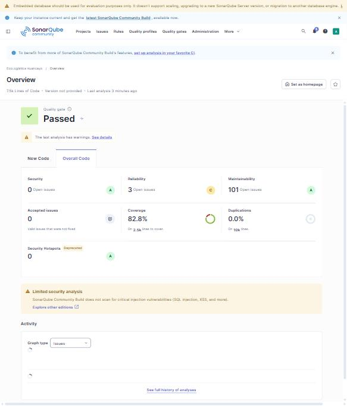

# Evaluación de Calidad de Código — SonarQube

[← Volver al README Principal](../../../README.md#93-fase-03-implementación)

**Nombre del Proyecto:** EcoLogística Huancayo — Plataforma de Optimización de Rutas Sostenibles de Última Milla  
**Fecha de Análisis:** 2026-10-30  
**Versión del Análisis:** V_1_0_0  

## Nota de vigencia y validación documental — 30/10/2026

> **Resultado histórico, no escaneo nuevo del último `main`.** Este informe conserva las medidas obtenidas en la instancia local de SonarQube sobre el commit **`9b31dd0`**: Quality Gate **PASSED**, cobertura **82,8 %**, cero vulnerabilidades detectadas, **101 code smells** y fiabilidad **C**. El repositorio se actualizó posteriormente hasta `e7e4a00d` (41 commits adicionales). El pipeline actual de GitHub Actions **no incluye SonarScanner**. No presentamos estas cifras como resultado del commit final sin una nueva ejecución.

Como equipo, verificamos que este informe sí contiene resultados, captura, interpretación, distribución de hallazgos, limitaciones y plan correctivo. Su estado es **apto como evidencia histórica del análisis original**. Para repetirlo sobre el commit actual y registrar resultados de manera verificable, añadimos la [validación de vigencia y procedimiento de reanálisis](20261030%20Validaci%C3%B3n%20del%20reporte%20SonarQube%20y%20rean%C3%A1lisis.md), así como el [script PowerShell de ejecución local](../../../scripts/analizar-sonarqube.ps1). Los nuevos resultados deben publicarse **solo después de correr SonarScanner** y confirmar el Quality Gate de ese mismo commit. El script prepara un reporte separado: `SONARQUBE-ULTIMO-ANALISIS.md`.

---

## Metadatos del documento

| Campo | Valor |
|---|---|
| Versión del documento | 1.1.0 |
| Herramienta | SonarQube Community Build 26.9.0.129388 (instancia local) + SonarScanner CLI 8.3.0.16463 |
| Perfil y Quality Gate | *Sonar way* (perfiles por defecto de Python, TypeScript y CSS) |
| Configuración | [`sonar-project.properties`](../../../sonar-project.properties) en la raíz del repositorio |
| Alcance | `backend/src`, `frontend/src`, `database/migrations` (código) · `backend/tests`, `frontend/tests` (pruebas) |
| Tamaño analizado | 83 archivos · 7 467 líneas de código (Python 2 646 · TypeScript 2 696 · CSS 2 125) |
| Rama y commit | `sprint-3/calidad-owasp-wcag`, commit `9b31dd0` (incluye rutas e indicadores y las rutas guardadas) |
| Documentos relacionados | [01 Revisión](01%20Revisi%C3%B3n%20del%20Sprint%20V_1_0_0.md) · [02 Retrospectiva](02%20Retrospectiva%20del%20Sprint%20V_1_0_0.md) · [04 OWASP](04%20OWASP%20V_1_0_0.md) · [05 WCAG](05%20WCAG%20V_1_0_0.md) |

## Historial de cambios

| Versión | Fecha | Autor | Cambio |
|---|---|---|---|
| 1.0.0 | 30/10/2026 | Hilario Talavera, Alexander Daniel | Análisis inicial, correcciones y análisis final; plan de remediación de la deuda restante. |
| 1.1.0 | 30/10/2026 | Zorrilla Apumayta, Alex Jesus | Nuevo análisis sobre el commit `9b31dd0` con la cobertura de backend y frontend; cifras actualizadas y captura del panel. El análisis de la versión 1.0.0 se conserva como histórico en la sección «Análisis anterior». |

## 1. Resumen Ejecutivo de Quality Gate

- **Estado del Quality Gate:** **PASSED** (estado `OK`)
- **Porcentaje de Cobertura de Pruebas (Coverage):** **82,8 %** (líneas 86,0 % · ramas 69,3 %)
- **Duplicación de Código:** **0,0 %**
- **Fecha y commit del análisis:** 30/10/2026, commit `9b31dd0` (no incluye el [PR #3](https://github.com/alexito-dev/EcoLogistica/pull/3) de regularización).



*Evidencia: panel de la instancia local de SonarQube (Quality Gate Passed, fiabilidad C con 3 incidencias, cobertura 82,8 %, duplicación 0,0 %).*

| Condición del Quality Gate (código nuevo) | Umbral | Valor | Estado |
|---|---|---:|:---:|
| Incidencias nuevas | 0 | 0 | ✅ |

Es el segundo análisis de esta instancia, que se creó el 30/10; el Quality Gate solo evalúa la condición de incidencias nuevas.

| Calificación | Análisis anterior (v1.0.0) | Análisis actual (v1.1.0) |
|---|:---:|:---:|
| Fiabilidad (*Reliability*) | A | **C** (3 incidencias abiertas, 0 bugs) |
| Seguridad (*Security*) | A | A |
| Revisión de seguridad (*Security Review*) | A | A |
| Mantenibilidad (*Maintainability*) | A | A |

La fiabilidad baja a C porque el modelo de calidad de esta versión cuenta 3 incidencias de impacto sobre la fiabilidad, aunque la métrica clásica de *bugs* sigue en 0: `typescript:S6772` y `typescript:S6845` (severidad media, en `LoginPage.tsx:212` y `PedidosTable.tsx:198`) y `typescript:S7758` (baja, en `MapaRutas.tsx:31`). Quedan en la deuda pendiente. `S6845` es el `tabIndex` de la tabla de pedidos con desplazamiento: se mantiene porque permite desplazarla con el teclado (WCAG 2.1.1).

### Cómo se obtuvo la cobertura

| Módulo | Herramienta | Pruebas | Cobertura |
|---|---|---:|---:|
| Backend (FastAPI) | `pytest --cov=app --cov-report=xml` | 137 aprobadas | 92,6 % de líneas |
| Frontend (React) | `vitest run --coverage` (`@vitest/coverage-v8`, reporte `lcov`) | 58 aprobadas | 76,0 % de líneas |
| **Total ponderado por SonarQube** | — | **195** | **82,8 %** |

La cobertura más baja está en los adaptadores PostgreSQL (`flota/postgres_repository.py` 33 %, `pedidos/postgres_repository.py` 38 %) y en `database_health.py` (30 %): las pruebas usan repositorios en memoria y la base real solo se verifica en el job de migraciones del CI. El motor de rutas (`rutas/planificador.py`) tiene 100 %.

## 2. Métricas Principales

| Categoría | Cantidad Detectada | Severidad (Bloqueante / Alta / Media / Baja) |
|---|---:|---|
| **Bugs** | **0** | 0 / 0 / 0 / 0 |
| **Vulnerabilidades** | **0** | 0 / 0 / 0 / 0 |
| **Code Smells** | **101** | 0 / 1 / 52 / 48 |
| **Security Hotspots** | **0** | — (ningún punto sensible por revisar) |

*Correspondencia de severidades de SonarQube:* Blocker → Bloqueante · Critical → Alta · Major → Media · Minor → Baja.

### Análisis anterior vs. actual

| Métrica | Análisis anterior (v1.0.0) | Análisis actual (v1.1.0) | Variación |
|---|---:|---:|---:|
| Bugs | 0 | 0 | = |
| Vulnerabilidades | 0 | 0 | = |
| Code smells | 97 | 101 | +4 |
| Incidencias de severidad alta | 1 (`planificar()`) | 1 (`PaginaRutas.tsx`) | = |
| Deuda técnica | 8 h 34 min | 8 h 47 min | +13 min |
| Cobertura | 81,3 % | 82,8 % | +1,5 pp |
| Duplicación | 0,0 % | 0,0 % | = |
| Pruebas backend / frontend | 130 / 52 | 137 / 58 | +13 |

Los 4 code smells adicionales vienen del código nuevo del sprint (rutas guardadas y aviso de sesión). La incidencia de severidad alta (`typescript:S3776`, complejidad cognitiva) ya no está en `planificar()`, que se refactorizó, sino en el componente [`PaginaRutas.tsx`](../../../frontend/src/pages/PaginaRutas.tsx).

### Distribución de los 101 code smells

| Regla | Cantidad | Qué pide | Dónde |
|---|---:|---|---|
| `typescript:S6759` | 23 | Marcar como `Readonly` las *props* de los componentes | Componentes y páginas React |
| `python:S9073` | 21 | Dividir aserciones compuestas en pruebas | `backend/tests/auth`, `tests/pedidos` |
| `python:S8409` | 15 | Quitar `response_model` redundante (ya está en el tipo de retorno) | Routers de FastAPI |
| `python:S5778` | 9 | Una sola llamada que pueda lanzar excepción dentro de `pytest.raises` | Pruebas de dominio y servicio |
| `typescript:S3358` | 7 | Extraer ternarios anidados | `PaginaFlota`, `PaginaRutas`, `PaginaIndicadores`, `LoginPage`, `MapaRutas` |
| `typescript:S6819` | 8 | Usar elementos nativos (`<output>`, `<section>`, `<dialog>`) en vez de `role` | Avisos de estado, `Drawer`, regiones desplazables |
| `typescript:S1874` | 5 | `FormEvent` está obsoleto en los tipos de React 19 | `LoginPage`, `PedidoForm` |
| `css:S7924` | 3 | Contraste de texto | `styles.css` — **falsos positivos**, verificados con axe (ver §3) |
| Otras (8 reglas) | 10 | `S3776` complejidad cognitiva (1, **Alta**, en `PaginaRutas.tsx`), `S6582` (2), `S4624` (2), `S6754`, `S6772`, `S6845`, `S7755`, `S7758` | Varios |

## 3. Plan de Remediación y Deuda Técnica

- **Deuda Técnica Estimada:** **8 h 47 min** (527 min) en el análisis actual; era **8 h 34 min** (514 min) en el anterior y **10 h 01 min** (601 min) en el análisis inicial. Índice de deuda dentro de la calificación **A** de mantenibilidad.
- **Principales hallazgos y acciones correctivas:**
  1. **Bug — botones sin `type` dentro de formularios** (`typescript:S9011`, severidad Media, 2 casos). En [`PaginaFlota.tsx`](../../../frontend/src/pages/PaginaFlota.tsx) los botones "Registrar vehículo / Guardar cambios" y "Guardar disponibilidad" dependían del tipo implícito. **Corrección aplicada:** `type="submit"` explícito. Fiabilidad de **C → A**.
  2. **Literal `/api/v1` repetido 5 veces** (`python:S1192`, Alta). **Corrección aplicada:** constante `PREFIJO_API` en [`main.py`](../../../backend/src/app/main.py) y registro de routers en un bucle.
  3. **Lambdas que capturan la variable del bucle** (`python:S1515`, Media, 2 casos) en [`planificador.py`](../../../backend/src/app/rutas/planificador.py) (`_vecino_mas_cercano` y el pulido 2-opt). Hoy no fallan porque la lambda se evalúa en la misma iteración, pero un cambio futuro podía introducir un error silencioso. **Corrección aplicada:** valor capturado como argumento por defecto (`desde=actual`, `v=vehiculo`). Las 16 pruebas de rutas siguen pasando.
  4. **Selectores CSS duplicados** (`css:S4666`, 2 casos: `.nav__item` y `.flota-vehiculo`) y **valor obsoleto** `word-break: break-word` (`css:S1874`). **Corrección aplicada:** reglas fusionadas sin cambiar el orden de la cascada; `overflow-wrap: anywhere`.
  5. **Contraste de texto en CSS** (`css:S7924`, 3 casos). Son textos sobre fondos translúcidos encima de degradados, que el análisis estático no puede resolver. **Verificación:** axe-core en navegador, en tema claro y oscuro, no reporta violaciones de contraste en esos elementos ([05 WCAG](05%20WCAG%20V_1_0_0.md)). Se marcan como falsos positivos. En cambio, la prueba en navegador encontró dos problemas reales que SonarQube no detectó; también se corrigieron.

#### Deuda pendiente priorizada

| Prioridad | Hallazgo | Esfuerzo estimado | Responsable | Destino |
|---:|---|---|---|---|
| 1 | `S3776` — complejidad cognitiva de `PaginaRutas.tsx` (límite 15). La de `planificar()` ya se corrigió y se confirma en este análisis | ≈ 1 h | Vera Zea, Jhoanna Hade | Sprint 4 |
| 2 | Fiabilidad C: `S6772`, `S6845`, `S7758`; y `S6819` — usar `<output>`, `<section aria-label>` y `<dialog>` nativos (relacionado con accesibilidad) | ≈ 1 h | Vera Zea, Jhoanna Hade | Sprint 4 |
| 3 | `S3358` / `S4624` — extraer ternarios y plantillas anidadas | ≈ 1 h | Vera Zea, Jhoanna Hade | Sprint 4 |
| 4 | `S8409` — quitar `response_model` redundante en 13 endpoints (comprobar que OpenAPI no cambie) | ≈ 30 min | Anco Porras, Jhean Pier Julio | Sprint 4 |
| 5 | `S6759` / `S1874` — `Readonly<Props>` y reemplazo de `FormEvent` | ≈ 2 h | Vera Zea, Jhoanna Hade | Sprint 4 |
| 6 | `S9073` / `S5778` — refactorizar aserciones de pruebas | ≈ 3 h | Isidro Casio, Jose Luis | Sprint 5 |
| 7 | Cobertura de adaptadores PostgreSQL con pruebas de integración en el job de PostGIS del CI | 4–6 h | Isidro Casio, Jose Luis | Sprint 4 |

**Meta para el próximo análisis:** 0 incidencias de severidad Alta, fiabilidad A, menos de 60 code smells, cobertura ≥ 85 % y análisis automático en cada PR (acciones 1 y 8 de la [retrospectiva](02%20Retrospectiva%20del%20Sprint%20V_1_0_0.md#acciones-a-realizar)).

### Cambios incluidos en este análisis

- **`S3776` de `planificar()` corregida en el código:** se dividió en `_cabe`, `_mejor_insercion` y `_construir_ruta` ([`planificador.py`](../../../backend/src/app/rutas/planificador.py)), sin cambiar el resultado: las 16 pruebas del planificador siguen pasando. SonarQube ya no la reporta ahí.
- **Pruebas nuevas:** 7 de backend (rutas guardadas) y 6 de frontend (rutas guardadas y aviso de sesión). Total: 137 de backend y 58 de frontend.
- Las cifras de este documento corresponden al análisis del 30/10/2026 sobre el commit `9b31dd0`. No incluyen los cambios posteriores del [PR #3](https://github.com/alexito-dev/EcoLogistica/pull/3); el siguiente análisis los incorporará.

## 4. Cómo reproducir el análisis

```powershell
# 1. Cobertura
Push-Location backend;  .\.venv\Scripts\python.exe -m pytest --cov=app --cov-report=xml:coverage.xml; Pop-Location
Push-Location frontend; npx vitest run --coverage; Pop-Location

# 2. SonarQube local (requiere Java 17+): iniciar con bin\windows-x86-64\StartSonar.bat
#    y generar un token de análisis en http://localhost:9000 (My Account → Security)
#    (en esta máquina: D:\sonar-local, fuera del repositorio)
sonar-scanner -D"sonar.host.url=http://localhost:9000" -D"sonar.token=$env:SONAR_TOKEN"
```

`coverage.xml`, `frontend/coverage/` y `.scannerwork/` están en `.gitignore`.
