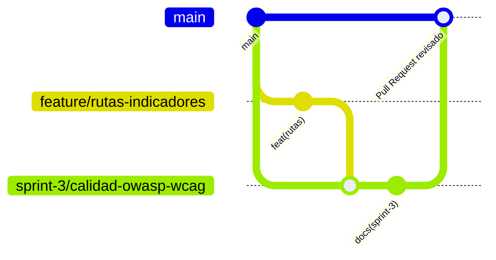

# Flujo de trabajo GitFlow

[← Volver al README Principal](../../../README.md#93-fase-03-implementación)

**Nombre del Proyecto:** EcoLogística Huancayo — Plataforma de Optimización de Rutas Sostenibles de Última Milla

**Líder del Proyecto:** Alex Jesus Zorrilla Apumayta

## Metadatos del documento

| Campo | Valor |
|---|---|
| Versión | 1.0.0 |
| Fecha | 30/10/2026 |
| Repositorio | <https://github.com/alexito-dev/EcoLogistica> |
| Referencia | [README, sección 7](../../../README.md#7-modelo-de-ramas-y-control-de-versiones) |
| Documentos relacionados | [01 Revisión](01%20Revisi%C3%B3n%20del%20Sprint%20V_1_0_0.md#pendientes) · [Plan de trabajo](20261030%20Plan%20de%20trabajo%20V_1_0_0.md) |

## Historial de cambios

| Versión | Fecha | Autor | Cambio |
|---|---|---|---|
| 1.0.0 | 30/10/2026 | Hilario Talavera, Alexander Daniel | Primera emisión: flujo adoptado, equivalencia con GitFlow y brechas verificadas. |

## 1. Flujo adoptado y su relación con GitFlow

El equipo acordó en la reunión del 29/10/2026 mantener un **GitFlow simplificado**, definido en el README: `main` como rama de integración, ramas cortas desde `main` y revisión mediante *Pull Request*. No usa `develop` ni ramas `release/*` permanentes.

| Elemento de GitFlow | En este proyecto | Observación |
|---|---|---|
| `main` (producción) | `main`, rama compartida de integración | No representa un despliegue productivo. |
| `develop` | **No se usa** | Existe `origin/developer` desactualizada desde el 18/09. |
| `feature/*` | `feature/*`, desde `main` | Ejemplos: `feature/autenticacion-mfa`, `feature/registro-pedidos`, `feature/rutas-indicadores`, `feature/sprint-2-flota-doc-audit`. |
| `release/*` | No se usa | Sin versión de entrega en Jira. |
| `hotfix/*` | No se usa | Sin entorno productivo. |
| Ramas de entrega por sprint | `sprint-3/calidad-owasp-wcag` | Agrupa la entrega del sprint e integra `feature/rutas-indicadores`. |
| Ramas de documentación | `docs/*` | `docs/semana-3-entregables`, `docs/sprint-1-diagramas`, `docs/sprint-2`. |

## 2. Reglas

1. Toda tarea nueva sale de `main` en una rama `feature/<tema>` o `docs/<tema>`.
2. Los commits siguen Conventional Commits v1.0.0 (`feat`, `fix`, `docs`, `test`, `refactor`, `style`, `chore`).
3. La integración a `main` es por Pull Request con revisión de otra persona.
4. Ninguna rama vive más de 5 días hábiles sin PR abierto (acción 3 de la [Retrospectiva](02%20Retrospectiva%20del%20Sprint%20V_1_0_0.md#acciones-a-realizar)).
5. El CI debe pasar antes de fusionar.

## 3. Estado verificado el 30/10/2026

| Aspecto | Estado |
|---|---|
| Remoto configurado | `origin` → `https://github.com/alexito-dev/EcoLogistica.git` |
| Ramas remotas | `main`, `developer`, `docs/semana-3-entregables`, `feature/rutas-indicadores`, `feature/sprint-2-flota-doc-audit`, `sprint-3/calidad-owasp-wcag` |
| Rama del Sprint 3 | Subida al remoto, al día con `origin` |
| PR hacia `main` | **Pendiente** (el PR n.° 2 de Sprint 2 sí se fusionó) |
| CI | Desde el 30/10 se dispara en *push* a `main`, `sprint-*/**` y `feature/**` y en cualquier `pull_request` |
| Protección de `main` y revisión obligatoria | No verificadas; el README las declara pendientes |

## 4. Brechas y acciones

| # | Brecha | Acción | Responsable | Fecha |
|---:|---|---|---|---|
| 1 | `developer` sigue existiendo en el remoto | Retirarla o documentar su uso | Isidro Casio, Jose Luis | 06/11/2026 |
| 2 | Sin PR de la rama del Sprint 3 | Abrir PR hacia `main` y pedir revisión | Isidro Casio, Jose Luis | 02/11/2026 |
| 3 | Protección de `main` sin configurar | Exigir PR y CI en verde | Zorrilla Apumayta, Alex Jesus | Sprint 4 |
