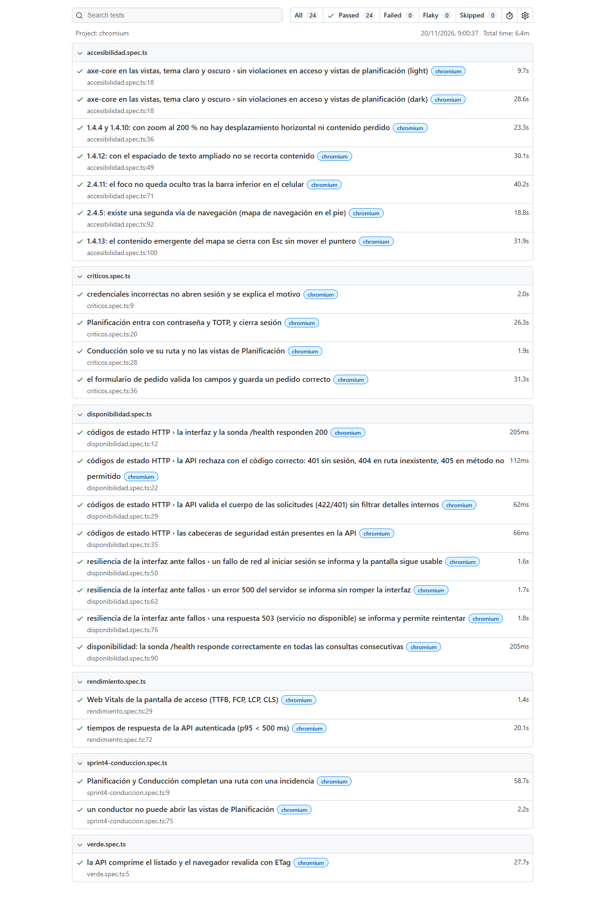
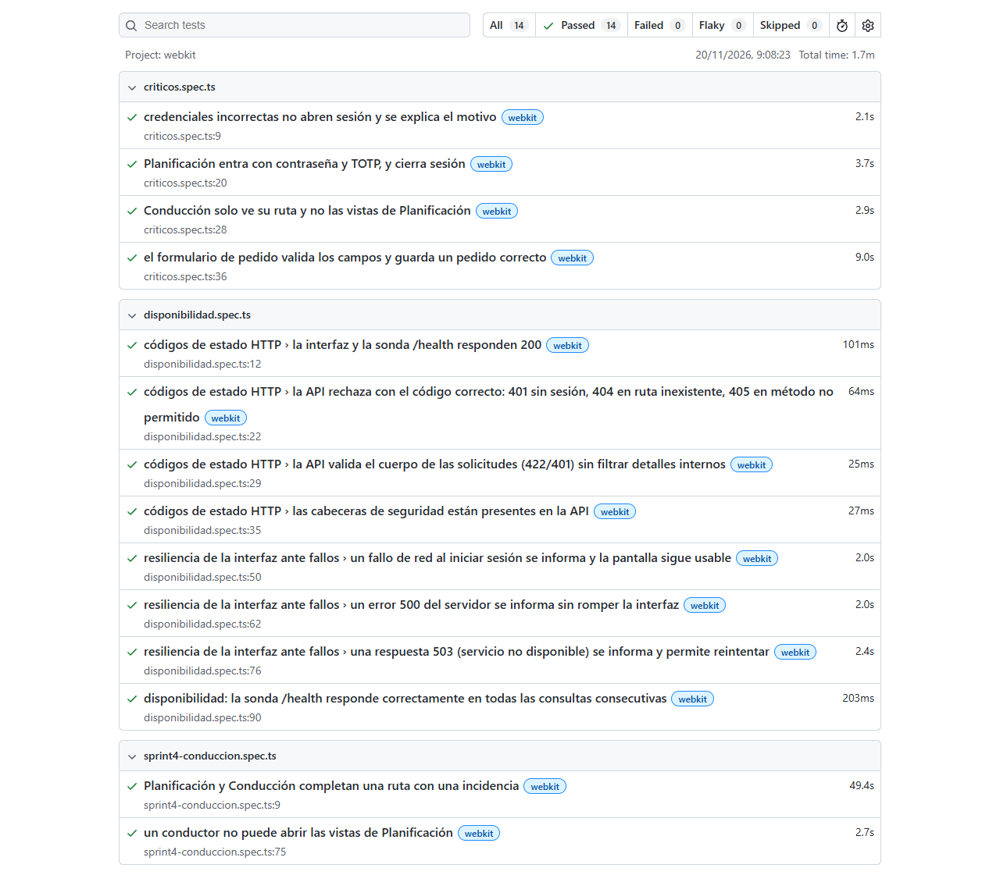

# Análisis de pruebas E2E y monitoreo con Playwright

[← Volver al README principal](../../../README.md#93-fase-03-implementación)

| Campo | Valor |
|---|---|
| Versión | 1.0.0 |
| Fecha | 20/11/2026 |
| Rama | `sprint-5/cicd-playwright-usabilidad` |
| Herramienta | Playwright 1.65 (`@playwright/test`) |
| Entorno de medición | Máquina de desarrollo (Windows 10), API FastAPI y build de producción de la interfaz servidos en local con datos temporales |
| Documentos relacionados | [Pruebas E2E y calidad del Sprint 4](../Sprint%2004/03%20Pruebas%20E2E%20y%20calidad%20V_1_0_0.md) · [`tests.yml`](../../../.github/workflows/tests.yml) |

> **Alcance de las mediciones.** Las cifras de este informe se midieron en una máquina de desarrollo con la API y la interfaz en `localhost`: describen el comportamiento del código, no el de una red real ni el de un servidor productivo, que **todavía no existe** (ver [sección 6](#6-lo-que-este-informe-no-demuestra)). Firefox no pudo ejecutarse en esa máquina; su resultado se toma de GitHub Actions (sección 2.3).

## Historial de cambios

| Versión | Fecha | Autor | Cambio |
|---|---|---|---|
| 1.0.0 | 20/11/2026 | Hilario Talavera, Alexander Daniel | Primera emisión: tres navegadores, flujos críticos, Web Vitals, tiempos de API y disponibilidad. |

## 1. Configuración del entorno de pruebas

### 1.1. Arquitectura de carpetas

```text
frontend/
├── playwright.config.ts          # proyectos, servidores web y variables de entorno
├── e2e/
│   ├── ayudas.ts                 # inicio de sesión con contraseña + TOTP (RFC 6238), navegación
│   ├── criticos.spec.ts          # Sprint 5 · autenticación, roles y formulario de pedidos
│   ├── disponibilidad.spec.ts    # Sprint 5 · códigos HTTP, fallos de red/servidor y uptime
│   ├── rendimiento.spec.ts       # Sprint 5 · Web Vitals y tiempos de la API (solo Chromium)
│   ├── sprint4-conduccion.spec.ts# recorrido Planificación → Conducción → incidencia
│   ├── accesibilidad.spec.ts     # axe-core y criterios WCAG 2.2 AA
│   └── verde.spec.ts             # compresión y caché condicional (Green IT)
└── playwright-report/            # informe HTML (no se versiona; lo ignora .gitignore)
```

### 1.2. `playwright.config.ts`

| Elemento | Configuración |
|---|---|
| Servidores | API real (`uvicorn`, puerto 8000, memoria y archivos temporales, **sin PostgreSQL**) y el **build de producción** de la interfaz (`vite preview`, puerto 3000) |
| Aislamiento | `DATABASE_URL` vacío: la suite nunca toca una base real; cuentas de demostración con clave fija solo para pruebas |
| Ejecución | `workers: 1` (el segundo factor TOTP de cada cuenta es de un solo uso), un reintento en CI, `trace: retain-on-failure`, captura de pantalla en fallos |
| Informe | `list` + `html` en `playwright-report/` |
| Localización | `es-PE`, zona horaria `America/Lima` |
| Entorno remoto | Con `ECO_BASE_URL` y `ECO_API_URL` no se levanta servidor local: sirve de prueba de humo tras un despliegue |

### 1.3. Navegadores evaluados

| Proyecto | Motor | Qué ejecuta | Motivo |
|---|---|---|---|
| `chromium` | Chromium (Chrome local; Chromium de Playwright en CI) | **Toda** la suite (24 pruebas) | Es el único con las API de Web Vitals (`largest-contentful-paint`, `layout-shift`) y concentra axe-core y los criterios WCAG |
| `firefox` | Firefox (Gecko) | Flujos críticos, recorrido de Conducción y disponibilidad (14 pruebas) | Segundo motor de renderizado |
| `webkit` | WebKit (Safari) | Las mismas 14 pruebas | Tercer motor; cubre Safari/iOS en lo funcional |

En CI, `tests.yml` ejecuta cada navegador en su propio trabajo (`strategy.matrix`, `fail-fast: false`) en modo *headless*, y guarda el informe HTML de cada uno como artefacto.

## 2. Pruebas End-to-End

### 2.1. Casos críticos

| Caso | Archivo | Qué comprueba |
|---|---|---|
| Autenticación rechazada | `criticos.spec.ts` | Una contraseña incorrecta muestra una alerta, no abre sesión y vacía el campo de contraseña |
| Autenticación completa | `criticos.spec.ts` | Contraseña + TOTP abre la sesión de Planificación; cerrar sesión retira el menú |
| Control de acceso por rol | `criticos.spec.ts`, `sprint4-conduccion.spec.ts` | Conducción solo ve «Mi ruta»; no ve Pedidos ni Seguimiento |
| Validación de formulario | `criticos.spec.ts` | Enviar vacío lista los campos obligatorios con enlaces; una ventana horaria invertida se rechaza sin guardar; corregida, el pedido aparece en la lista |
| Flujo principal de negocio | `sprint4-conduccion.spec.ts` | Planificación guarda rutas y asigna conductor → Conducción entrega una parada y reporta incidencia → Planificación la ve, reprograma, reoptimiza y consulta los indicadores observados |
| Accesibilidad | `accesibilidad.spec.ts` | axe-core en todas las vistas (tema claro y oscuro) y criterios WCAG 1.4.4, 1.4.12, 1.4.13, 2.4.5 y 2.4.11 |
| Green IT | `verde.spec.ts` | La API comprime el listado (Brotli/Gzip) y el navegador revalida con ETag |

Fragmento representativo (validación de formulario, ejecutado en los tres navegadores):

```ts
await form.getByRole('button', { name: 'Guardar pedido' }).click()
const resumen = form.getByRole('alert').filter({ hasText: /Dirección/ })
await expect(resumen).toBeVisible()
await expect(resumen.getByRole('link', { name: 'Latitud' })).toBeVisible()
// ventana invertida: se rechaza y no se guarda
await form.getByLabel('Ventana: inicio').fill('2026-12-01T14:00')
await form.getByLabel('Ventana: fin').fill('2026-12-01T09:00')
await form.getByRole('button', { name: 'Guardar pedido' }).click()
await expect(page.getByText(direccion)).toHaveCount(0)
```

### 2.2. Resultados de ejecución

| Navegador | Pruebas | Aprobadas | Falladas | Duración | Dónde se midió |
|---|---:|---:|---:|---|---|
| Chromium | 24 | **24** | 0 | 6,4 min | Máquina de desarrollo, 20/11/2026 |
| WebKit | 14 | **14** | 0 | 1,7 min | Máquina de desarrollo, 20/11/2026 |
| Firefox | 14 | No ejecutado localmente | — | — | En esta máquina Firefox no arranca (`browserType.launch: spawn UNKNOWN`, falta el runtime de Visual C++). Resultado en [GitHub Actions](#23-resultado-en-github-actions) |

**Tasa de éxito local:** 38 de 38 pruebas ejecutadas aprobadas (**100 %**), sin reintentos. Las de Firefox se cuentan solo desde su ejecución en CI (sección 2.3).

Evidencia: informes HTML de Playwright generados en esas ejecuciones.





### 2.3. Resultado en GitHub Actions

Ejecución de [`tests.yml`](../../../.github/workflows/tests.yml) sobre el commit `5f750bf` de la rama del sprint ([ejecución 44755819508](https://github.com/alexito-dev/EcoLogistica/actions/runs/44755819508)), en Ubuntu, modo *headless*, **estado: Success en 6 min 29 s**:

| Navegador (trabajo `E2E Playwright`) | Pruebas | Aprobadas | Falladas | Duración |
|---|---:|---:|---:|---|
| Chromium | 24 | **24** | 0 | 5,8 min |
| Firefox | 14 | **14** | 0 | 1,7 min |
| WebKit | 14 | **14** | 0 | 1,6 min |

Cada trabajo publica el artefacto `playwright-report-<navegador>` (informe HTML). Los trabajos de backend (pytest y benchmark), frontend (Vitest), integración con PostgreSQL + PostGIS y cobertura integral de la misma ejecución también concluyeron en verde.

### 2.4. Hallazgos durante la construcción de la suite

| Hallazgo | Causa | Resolución |
|---|---|---|
| La prueba del formulario guardaba la dirección en el buscador de la lista | `getByLabel('Dirección')` coincidía con el buscador «Buscar pedidos por código, dirección o distrito» | Los campos se buscan dentro del diálogo (`getByRole('dialog')`) |
| Dos pruebas de resiliencia fallaban al esperar el botón «Continuar» habilitado | Por diseño la contraseña se borra tras cada rechazo y el botón queda deshabilitado hasta escribirla | La prueba verifica que el correo se conserva y que, al volver a escribir la contraseña, se puede reintentar |
| Firefox en CI: la página se cuelga (`Page crashed`) al ejecutar axe-core sobre el mapa de «Mi ruta» | Combinación de Firefox, el mapa Leaflet y el análisis de axe en el runner de CI | axe-core se ejecuta solo en Chromium en ese recorrido; la accesibilidad sigue auditándose en `accesibilidad.spec.ts` y en los otros navegadores se compara el flujo de negocio |
| WebKit en CI: una espera de 10 s por «Incidencias abiertas» expiró una vez (intermitente, pasó en el reintento) | Latencia del runner al recargar Seguimiento | Espera de 25 s en esa comprobación; la ejecución final pasó sin reintentos |
| Una prueba de unidad del backend ya fallaba en `main` | `pyotp` 2.12 exige secretos de al menos 112 bits y el test usaba uno de 80 | El test usa un secreto de 160 bits, como el que genera la aplicación |

## 3. Monitoreo de rendimiento

Archivo [`rendimiento.spec.ts`](../../../frontend/e2e/rendimiento.spec.ts), solo Chromium. Mide con `PerformanceObserver` y la *Navigation Timing API* sobre el **build de producción**, adjunta los valores al informe HTML (`web-vitals.json`, `api-tiempos.json`) y los imprime en consola.

### 3.1. Web Vitals de la pantalla de acceso

| Métrica | Resultado medido | Umbral de la prueba | Referencia Core Web Vitals | Estado |
|---|---:|---:|---|---|
| TTFB (tiempo hasta el primer byte) | 9 ms | < 800 ms | ≤ 800 ms es bueno | Cumple |
| FCP (primer contenido) | 236 ms | < 1 800 ms | ≤ 1 800 ms es bueno | Cumple |
| LCP (mayor contenido) | 236 ms | < 2 500 ms | ≤ 2 500 ms es bueno | Cumple |
| CLS (desplazamiento de diseño) | 0 | < 0,1 | ≤ 0,1 es bueno | Cumple |
| Carga completa (`load`) | 197 ms | — | — | Informativo |

Es una medición de una sola carga, en `localhost`, sin latencia de red; sirve para detectar regresiones, no como promesa de rendimiento en producción. Los umbrales más exigentes del proyecto (móvil simulado con Lighthouse: FCP 0,92 s, LCP 1,22 s, TBT 41 ms) siguen vigentes en [`green-audit.yml`](../../../.github/workflows/green-audit.yml).

### 3.2. Tiempos de respuesta de la API autenticada

20 solicitudes consecutivas por endpoint, con sesión de Planificación (cookie), tiempo medido de extremo a extremo desde el cliente:

| Endpoint | Estado | Mediana | p95 | Máximo | Umbral p95 |
|---|---:|---:|---:|---:|---:|
| `GET /api/v1/auth/sesion` | 200 | 14 ms | 34 ms | 38 ms | < 500 ms |
| `GET /api/v1/pedidos?limite=12` | 200 | 19 ms | 24 ms | 29 ms | < 500 ms |
| `GET /api/v1/vehiculos` | 200 | 18 ms | 25 ms | 25 ms | < 500 ms |
| `GET /api/v1/indicadores?fecha=<mañana>` | 200 | 25 ms | 31 ms | 52 ms | < 500 ms |

Todos cumplen con amplio margen. Se hicieron con datos de demostración (6 pedidos, 3 vehículos) y almacenamiento en memoria; con PostgreSQL y volumen real los tiempos serán mayores y deben remedirse. El motor de rutas tiene además su propio benchmark (`backend/scripts/benchmark_rutas.py`, objetivo ≤ 45 s) que `tests.yml` ejecuta en cada cambio.

## 4. Disponibilidad y resiliencia

Archivo [`disponibilidad.spec.ts`](../../../frontend/e2e/disponibilidad.spec.ts), en los tres navegadores (8 pruebas por navegador).

### 4.1. Códigos de estado HTTP verificados

| Solicitud | Código esperado | Resultado |
|---|---:|---|
| `GET /` (interfaz) | 200, `text/html` | Cumple |
| `GET /health` (sonda de la API, nueva en este sprint) | 200 con `{"status":"ok"}` | Cumple |
| `GET /api/v1/auth/sesion` sin sesión | 401 | Cumple |
| `GET /api/v1/pedidos` sin sesión | 401 | Cumple |
| `GET /api/v1/no-existe` | 404 | Cumple |
| `DELETE /api/v1/auth/sesion` (método no permitido) | 405 | Cumple |
| `POST /api/v1/auth/login` con cuerpo inválido | 400, 401 o 422 y sin trazas internas | Cumple |
| Cabeceras de la API | `X-Content-Type-Options: nosniff` y `X-Frame-Options: DENY` | Cumple |

### 4.2. Manejo de errores de red y de servidor en la interfaz

Se interceptan las llamadas de inicio de sesión con `page.route` para simular fallos:

| Fallo simulado | Comportamiento exigido | Resultado |
|---|---|---|
| Red caída (`abort('failed')`) | La interfaz muestra una alerta, conserva el correo y permite reintentar | Cumple en Chromium y WebKit |
| Error 500 del servidor | Alerta visible, sin errores de JavaScript sin capturar (`pageerror`) | Cumple en Chromium y WebKit |
| Servicio no disponible (503) | Alerta visible y un segundo intento sale realmente a la red | Cumple en Chromium y WebKit |

### 4.3. Uptime

La prueba sondea `/health` 30 veces consecutivas y exige una disponibilidad ≥ 99 %:

| Navegador | Sondas | Correctas | Disponibilidad | p95 | Máximo |
|---|---:|---:|---:|---:|---:|
| Chromium | 30 | 30 | 100 % | 10 ms | 12 ms |
| WebKit | 30 | 30 | 100 % | 8 ms | 13 ms |

> **Limitación.** Esto mide la disponibilidad del proceso local durante unos segundos, **no** el *uptime* de un entorno desplegado: no hay producción todavía. Cuando exista, la misma prueba se ejecuta contra ella en el trabajo `humo` de [`deploy-production.yml`](../../../.github/workflows/deploy-production.yml) con `ECO_BASE_URL` y `ECO_API_URL`, y su resultado debe registrarse en la versión 1.1.0 de este informe. Para un *uptime* real, se necesita un monitor externo continuo sobre `/health`.

## 5. Integración con CI/CD

| Flujo | Qué hace con Playwright |
|---|---|
| [`tests.yml`](../../../.github/workflows/tests.yml) | Trabajo `E2E Playwright` en matriz `chromium`, `firefox`, `webkit`; instala el navegador con `playwright install --with-deps`; sube `playwright-report-<navegador>` (30 días) y, si falla, las trazas y capturas |
| [`deploy-production.yml`](../../../.github/workflows/deploy-production.yml) | Tras desplegar, ejecuta `disponibilidad.spec.ts` contra la URL de producción y publica `playwright-report-produccion` |

## 6. Lo que este informe no demuestra

- No mide un entorno desplegado: no hay hosting productivo ni URL pública. El flujo de despliegue está implementado pero **no se ha ejecutado** hasta que el equipo cree los servicios y defina los secretos `DEPLOY_HOOK_BACKEND`, `DEPLOY_HOOK_FRONTEND` y las variables `PRODUCTION_URL` y `PRODUCTION_API_URL`.
- No incluye pruebas contra PostgreSQL en E2E (las usa solo la integración de `tests.yml`, con PostGIS aislado).
- Las métricas de rendimiento son de una máquina de desarrollo y de una sola carga; no reemplazan una prueba de carga.
- Firefox solo se ha ejecutado en GitHub Actions, no en la máquina de desarrollo.
